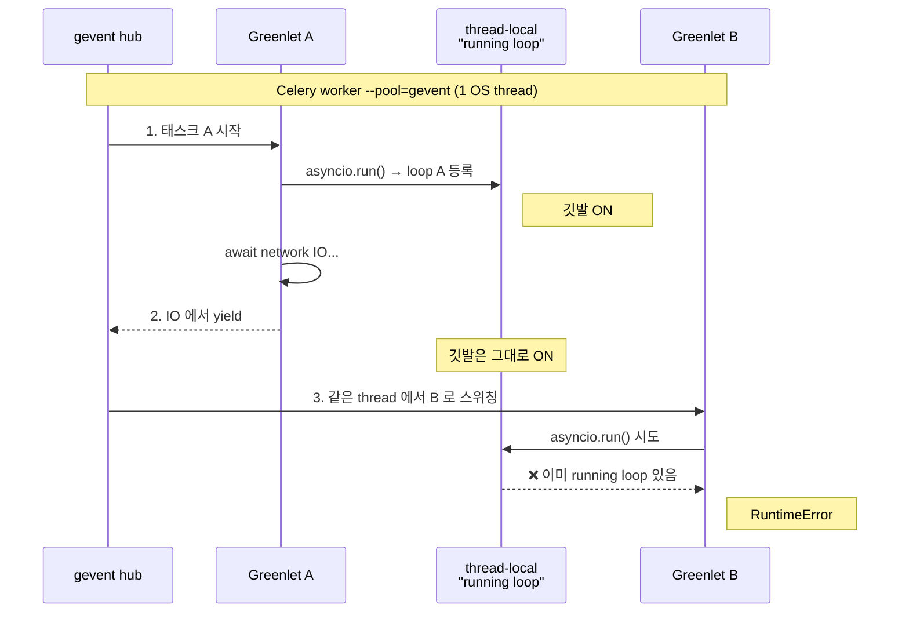

크롤링용 Celery 태스크에서 아래 에러가 **간헐적으로** 올라오는 걸 디버깅하다가 정리한다.

```
RuntimeError: asyncio.run() cannot be called from a running event loop
```

같은 코드인데 어떨 땐 멀쩡히 돌고 어떨 땐 터진다는 게 핵심이다. 그럴 땐 보통 race condition 을 의심하는 게 맞다.

## 문제 상황

대략 이런 구조의 Celery 태스크가 있었다.

```python
# Celery task 안에서 호출됨
def start_crawl(self, context):
    asyncio.run(self.crawl_task(context))
```

그리고 이 워커는 gevent pool 로 실행되고 있었다.

```bash
celery -A app worker --pool=gevent --concurrency=...
```

## 1차 원인 — gevent worker 위에서 asyncio.run

`--pool=gevent` 인 워커는 **이미 gevent hub (=이벤트 루프) 위에서** 돌고 있다. 그 위에서 `asyncio.run()` 을 또 부르면 Python 이 "이 thread 에 이미 running loop 가 있나?" 검사를 하는데, gevent 친화적으로 monkey patch 가 안 된 상태면 이 검사가 통과되지 못해서 터진다.

같은 프로젝트의 cron 진입점은 `gevent.monkey.patch_all()` 을 import 보다 먼저 부르고 있어서 asyncio 의 `BaseEventLoop.is_running()` 같은 경로가 패치되어 멀쩡히 동작했지만, Celery 진입점은 일부 패치만 하고 `monkey.patch_all()` 은 부르지 않고 있었다.

여기까지가 1차 가설인데, 이 가설로는 **항상** 터져야 한다는 결론이 나온다. 실제로는 가끔만 터지니까 설명이 안 된다.

## 진짜 원인 — 같은 워커에 동시에 들어오는 두 태스크

진짜 root cause 는 동시성이다. gevent pool 의 동작 방식을 떠올리면 답이 나온다.

- gevent pool 워커 = **하나의 OS thread 안에서 여러 greenlet 이 협력적으로 번갈아 실행**
- asyncio 의 "현재 running loop" 깃발은 **thread-local** 로 저장됨

이 두 개가 부딪힌다.



순서대로 보면

1. 태스크 A 가 `asyncio.run(coro)` 호출 → 새 event loop 를 만들어 **현재 thread 의 running loop 로 등록**
2. coro 안에서 IO 를 만나 **gevent hub 로 양보**
3. Hub 가 같은 thread 의 다른 greenlet (= 동시에 들어온 태스크 B) 으로 스위칭
4. 태스크 B 도 `asyncio.run()` 호출 → asyncio 가 thread-local 을 보는데 **A 가 등록해둔 loop 가 아직 running 으로 보임** → `RuntimeError`

## "간헐적" 이었던 이유

이 race 가 발생하려면 다음 조건이 **전부** 만족돼야 한다.

- 같은 gevent worker 프로세스 안에 `asyncio.run()` 을 부르는 태스크가 **2개 이상 동시에** 잡혀야 함
- 그 중 하나 (A) 가 `asyncio.run()` 안에서 IO 로 양보하는 타이밍이 있어야 함
- 그 양보된 짧은 틈에 hub 가 같은 워커 안의 다른 greenlet (B) 으로 스위칭해야 함
- B 도 마침 그 시점에 `asyncio.run()` 을 부르려고 해야 함

조건이 까다로워 보이지만, 크롤러처럼 네트워크 IO 에서 양보가 거의 확실히 일어나는 태스크라면 실제로는 **"같은 워커에 두 개 이상 동시에 잡히면 거의 항상 터진다"** 에 가깝다.

반대로 안 터지는 케이스도 명확하다.

- 워커에 태스크가 **1개만** 잡힘 → A 가 끝나면서 깃발도 같이 내려가니 안전
- 두 태스크가 **다른 워커 프로세스**에 잡힘 → 프로세스가 다르니 thread-local 도 별개. `--pool=prefork` 였다면 항상 이쪽
- 같은 워커지만 **시간차가 큼** → A 가 완전히 끝난 뒤 B 가 시작되는 경우

## 해결 방향

선택지는 대략 이런 것들이 있다.

1. **Celery worker pool 을 prefork 로 변경** — 가장 깔끔. 다만 동시성 모델이 바뀌니 다른 코드에 미치는 영향을 봐야 함
2. **asyncio.run 대신 dedicated native thread 에서 loop 를 돌림** — gevent hub 와 별개의 thread 라 thread-local 이 격리됨
3. **subprocess 로 분리** — cron 쪽에서 이미 쓰던 방식. 무겁지만 확실함
4. **해당 로직을 Celery 가 아닌 다른 컴포넌트로 이동** — async 가 정말 필요한 곳이라면 Celery worker 안에서 도는 것 자체가 부자연스러울 수 있음

## 정리

- gevent pool 위에서 `asyncio.run()` 을 부르는 건 그 자체로 위험 신호다
- "단일 호출은 멀쩡한데 동시 실행에서만 터진다" 면 thread-local 같은 **공유 상태**를 의심하라
- 동시성 모델 (gevent / asyncio / prefork) 을 섞을 때는 **상태가 어디에 저장되는지** 를 항상 확인해야 한다

## 참고

- [asyncio.run — Python docs](https://docs.python.org/3/library/asyncio-runner.html#asyncio.run)
- [gevent — Concepts](https://www.gevent.org/intro.html)
- [Celery — Concurrency with gevent](https://docs.celeryq.dev/en/stable/userguide/concurrency/gevent.html)
